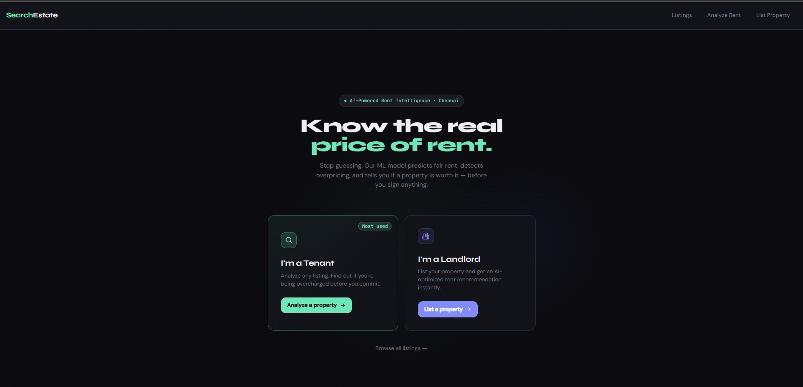
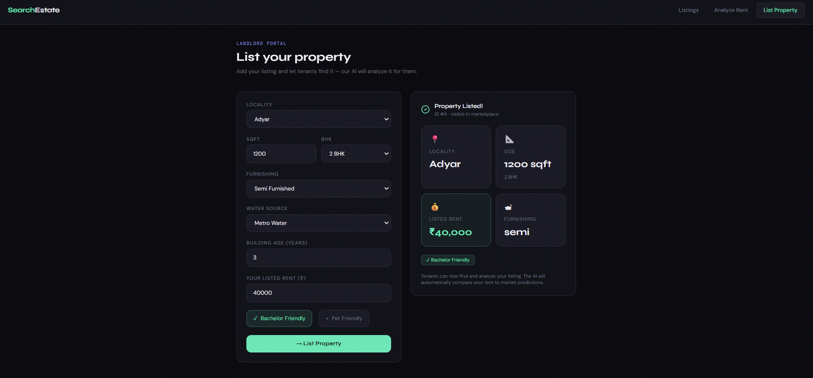
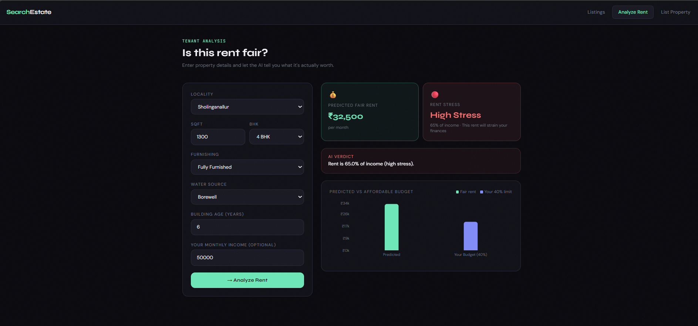
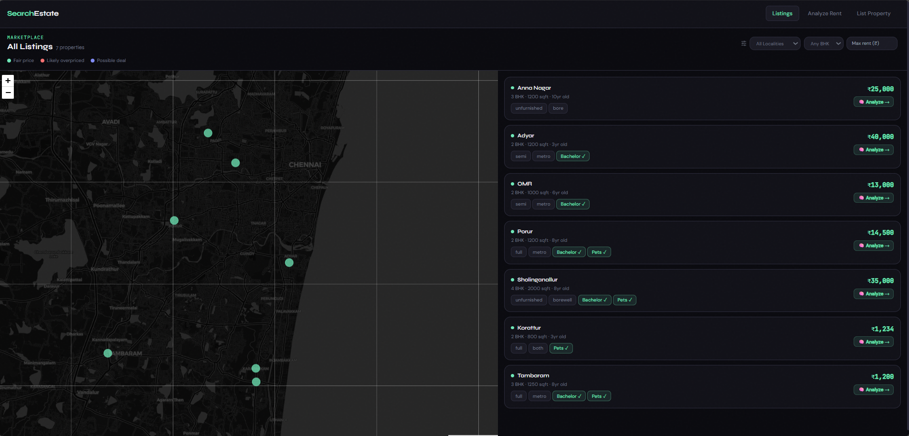
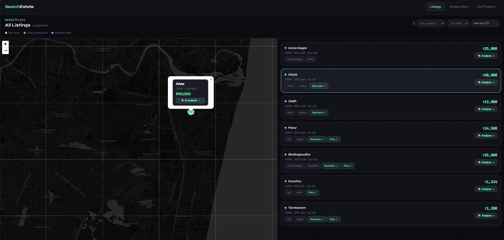
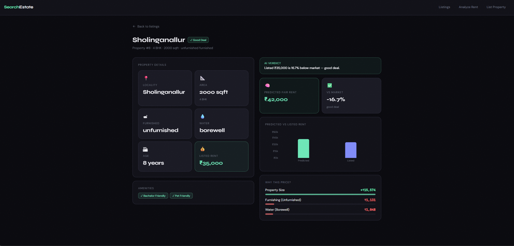

<<<<<<< HEAD
# 🏙 SearchEstate — AI-Powered Rental Intelligence Platform

> Know the real price of rent. Stop guessing.

---

## 🚀 Overview

**SearchEstate** is a full-stack AI-powered platform that helps:

* 🧑‍💼 **Tenants** evaluate rent affordability and avoid overpaying
* 🏢 **Landlords** optimize pricing before listing
* 🏘 **Users** explore properties through intelligent insights + maps

It combines:

* Machine Learning (rent prediction)
* Explainable AI (SHAP)
* Marketplace listings
* Geospatial visualization

---

## 🔥 Key Features

### 🧠 AI Rent Prediction

* Predicts fair rent using ML (XGBoost)
* Detects overpriced listings
* Provides decision-ready insights

---

### 📊 Explainable AI (SHAP)

* Shows **why** a price is predicted
* Displays feature contributions
* Visual bar-based explanation

---

### 🧑‍💼 Tenant Decision Engine

* Calculates rent stress (% of income)
* Human-friendly verdicts:

  * 🟢 Affordable
  * ⚠️ Moderate Strain
  * 🔴 High Stress

---

### 🏢 Landlord Listing System

* Add property details
* Instantly list in marketplace
* AI-ready listings for tenants

---

### 🏘 Marketplace + Filters

* Browse all listings
* Filter by locality, BHK, rent
* AI verdict directly on listings

---

### 🗺 Geospatial Visualization

* Map-based browsing (Leaflet)
* Click marker → highlight listing
* Fully synced map + list experience

---

## 🖼 Screenshots

### 🏠 Home Page



---

### 🏢 Landlord Listing Page



---

### 🔍 Property Analysis (AI + SHAP)



---

### 🗺 Listings + Map View



---

### 🧠 Interactive Map + Selection



---

### 🧠 Deep Property Analysis (AI + SHAP)



This view provides a complete breakdown of a property:

- 📍 Property details (location, size, furnishing, water, age)
- 💰 Predicted fair rent using ML
- 📉 Overpricing analysis vs market
- 📊 Visual comparison (predicted vs listed)
- 🧠 SHAP-based explanation:
  - Shows which features increased or decreased rent
  - Human-readable feature impact
  - Color-coded contribution bars

👉 This transforms raw predictions into **transparent, explainable decisions**

## 🧠 How It Works

1. User inputs property details or selects a listing
2. ML model predicts fair rent
3. System calculates:

   * overpricing
   * affordability
   * rent stress
4. SHAP explains the prediction
5. Results displayed via UI + charts + map

---

## 📊 Core Logic

**Overpricing**

```text
(listed_rent - predicted_rent) / predicted_rent
```

**Rent Stress**

```text
rent / income
```

---

## 🏗 Tech Stack

### Frontend

* React (Vite)
* Tailwind CSS
* Recharts
* React Leaflet

### Backend

* FastAPI
* SQLAlchemy

### Database

* PostgreSQL (production-ready)
* SQLite (development)

### Machine Learning

* XGBoost
* SHAP
* Scikit-learn
* Pandas / NumPy

---

## ⚙️ Setup Instructions

### Backend

```bash
cd backend
pip install -r requirements.txt
uvicorn main:app --reload
```

### Frontend
=======
# 🏙 SEARCH ESTATE: Chennai Rental Intelligence Platform

An explainable, AI-powered real estate rental marketplace and cloud computing mini-project engineered for Chennai, Tamil Nadu.

Extends a full-stack property application with **Amazon RDS for PostgreSQL** and **AWS Lambda** serverless ML inference.

---

## 🚀 Key Features

- 🧠 **Serverless Rent Prediction:** XGBoost regression estimating fair market rent.
- 📊 **SHAP Explainability:** Top-3 feature contributions (property size, locality, building age) explaining *why* a specific rent was predicted.
- 📉 **Overpricing Detection:** Automated delta analysis comparing landlord listed rent against predicted fair rent (+10% threshold).
- 💸 **Rent Stress Analysis:** Evaluates tenant affordability against monthly income (>40% threshold).
- 🏠 **Marketplace & Map Exploration:** Interactive Leaflet map with fly-to coordinates, locality filters, and listing detail cards.
- ☁️ **Dual-Mode Cloud Architecture:**
  - **Storage:** Amazon RDS PostgreSQL (production) with seamless local SQLite/PostgreSQL fallback.
  - **Inference:** Serverless AWS Lambda (production) with automatic local in-process fallback.

---

## 🧱 Architecture & Tech Stack

```
[ React 18 / Vite SPA ]  (Port 5173)
        │
        ▼ HTTP / JSON
[ FastAPI Application Backend ] (Port 8000)
   ├── Database Layer (Alembic + SQLAlchemy)
   │     ├── Production: Amazon RDS for PostgreSQL (TLS enforced)
   │     └── Local/Dev:  Local PostgreSQL or SQLite (app.db)
   └── Prediction Provider Layer
         ├── Production: AWS Lambda (XGBoost + Native C++ Tree SHAP)
         └── Local/Dev:  In-process XGBoost + SHAP Explainer
```

---

## ⚙️ Quick Start

### 1. Backend Setup

```bash
cd backend

# Create & activate virtual environment (if not already done)
python -m venv venv
# Windows:
.\venv\Scripts\activate
# Linux/macOS:
source venv/bin/activate

# Install dependencies
pip install -r requirements.txt

# Configure environment
cp .env.example .env
# Edit .env with your database URL or leave default for local SQLite

# Run database migrations
alembic upgrade head

# Run development server
uvicorn main:app --reload
```
API runs at `http://127.0.0.1:8000` (Interactive docs at `http://127.0.0.1:8000/docs`).

### 2. Frontend Setup
>>>>>>> cb7acc3 (Prepare rent prediction for AWS deployment)

```bash
cd frontend
npm install
npm run dev
```
<<<<<<< HEAD

---

## 🧭 Project Highlights

* Full-stack ML system (not just a model)
* Explainable AI integration (SHAP)
* Real-world product UX (map + insights)
* Database-agnostic architecture
* Clean UI with decision-focused design

---

## 🚀 Future Improvements

* Vacancy prediction model
* Advanced filters
* Real dataset integration
* Deployment (cloud)

---

## 💡 Author

Built as a full-stack + ML portfolio project demonstrating:

* system design
* AI integration
* product thinking

---
=======
Web application runs at `http://localhost:5173`.

---

## 🧪 Automated Testing & Benchmarking

### Run Automated Test Suite
```bash
pytest backend/tests/ -v
```
Runs 18 automated regression and integration tests verifying:
- Database connectivity (SQLite fallback and PostgreSQL).
- Alembic schema migrations and stable primary key constraints.
- Property CRUD and duplicate detection (allowing distinct units).
- Local model vs. Lambda handler exact numerical parity ($\pm$ ₹0).
- Automatic local fallback when cloud Lambda is unreachable.

### Run Local Lambda Handler Tests
```bash
python lambda/test_lambda_local.py
```

### Run Performance Latency Benchmark
```bash
python backend/scripts/benchmark_latency.py
```

---

## 📖 Cloud Deployment Guide

See [CLOUD_DEPLOYMENT.md](CLOUD_DEPLOYMENT.md) for complete instructions on:
- Amazon RDS provisioning, security group configuration, and TLS setup.
- AWS Lambda packaging, ECR container deployment, and Function URLs.
- Cost analysis, free-tier limits, and resource cleanup instructions.
- Viva questions and technical defense guide.
>>>>>>> cb7acc3 (Prepare rent prediction for AWS deployment)
